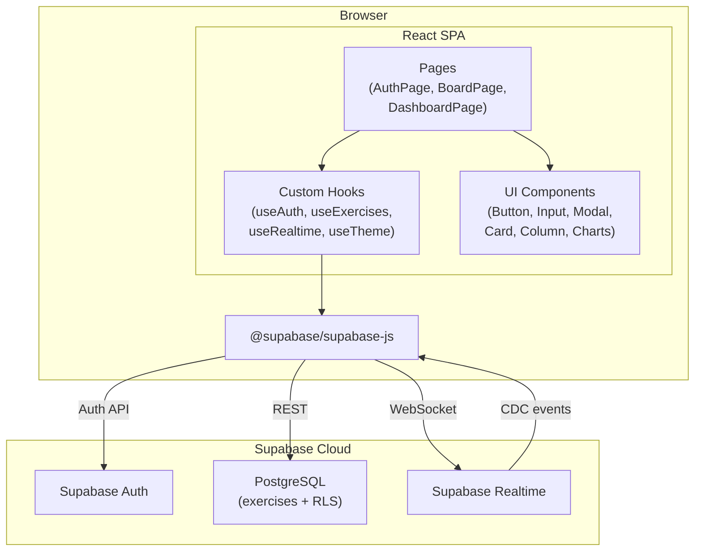

# Design Document — GymFlow

## Overview

O GymFlow é uma aplicação web de gestão de treinos no estilo Kanban. O frontend é uma SPA construída com **React 18 + Vite + TailwindCSS**, que se comunica exclusivamente com o **Supabase** como backend-as-a-service (autenticação, banco de dados PostgreSQL e sincronização em tempo real via WebSocket). O build final é um conjunto de arquivos estáticos implantados no **Render**.

---

## Architecture

### Diagrama de Alto Nível



---

## Components and Interfaces

### Estrutura de Pastas

```
src/
├── components/
│   ├── ui/           # Button, Input, Modal, Spinner, Badge, ThemeToggle
│   ├── auth/         # LoginForm, SignupForm, ProtectedRoute
│   ├── board/        # Board, Column, ExerciseCard, ExerciseForm, DragOverlay
│   ├── dashboard/    # MetricCard, WeeklyChart, EmptyState
│   └── layout/       # AppLayout, Navbar
├── hooks/
│   ├── useAuth.ts
│   ├── useExercises.ts
│   ├── useRealtime.ts
│   ├── useTheme.ts
│   └── useDashboard.ts
├── lib/
│   ├── supabase.ts
│   ├── exerciseSerializer.ts
│   └── metrics.ts
├── pages/
│   ├── AuthPage.tsx
│   ├── BoardPage.tsx
│   └── DashboardPage.tsx
├── types/
│   └── index.ts
└── test/
    ├── setup.ts
    └── arbitraries.ts
```

### Interfaces TypeScript Principais

```typescript
export type ExerciseStatus = 'backlog' | 'hoje' | 'fazendo' | 'feito';

export interface Exercise {
  id: string;
  user_id: string;
  title: string;
  sets: number;
  reps: number;
  weight: number;
  status: ExerciseStatus;
  created_at: string;
}

export interface ExerciseFormData {
  title: string;
  sets: number;
  reps: number;
  weight: number;
  status: ExerciseStatus;
}

export interface DashboardMetrics {
  totalFeito: number;
  cargaTotal: number;
  frequenciaSemanal: number;
  last7Days: DayMetric[];
}

export interface DayMetric {
  date: string;
  count: number;
}

export type Theme = 'dark' | 'light';
export type ConnectionStatus = 'connected' | 'disconnected' | 'reconnecting';
```

---

## Data Models

### Tabela `exercises`

| Coluna       | Tipo           | Restrições                                                              |
|--------------|----------------|-------------------------------------------------------------------------|
| `id`         | UUID           | PRIMARY KEY DEFAULT gen_random_uuid()                                   |
| `user_id`    | UUID           | NOT NULL REFERENCES auth.users(id) ON DELETE CASCADE                    |
| `title`      | TEXT           | NOT NULL                                                                |
| `sets`       | INTEGER        | NOT NULL CHECK (sets > 0)                                               |
| `reps`       | INTEGER        | NOT NULL CHECK (reps > 0)                                               |
| `weight`     | NUMERIC(8,2)   | NOT NULL CHECK (weight >= 0)                                            |
| `status`     | TEXT           | NOT NULL CHECK (status IN ('backlog','hoje','fazendo','feito')) DEFAULT 'backlog' |
| `created_at` | TIMESTAMPTZ    | NOT NULL DEFAULT now()                                                  |

### Políticas RLS

```sql
ALTER TABLE exercises ENABLE ROW LEVEL SECURITY;

CREATE POLICY "select_own" ON exercises FOR SELECT USING (auth.uid() = user_id);
CREATE POLICY "insert_own" ON exercises FOR INSERT WITH CHECK (auth.uid() = user_id);
CREATE POLICY "update_own" ON exercises FOR UPDATE USING (auth.uid() = user_id) WITH CHECK (auth.uid() = user_id);
CREATE POLICY "delete_own" ON exercises FOR DELETE USING (auth.uid() = user_id);
```

---

## Correctness Properties

### Property 1: Round-trip de serialização
Para qualquer exercício válido `e`, `deserializar(serializar(e))` deve ser profundamente igual a `e`.
**Validates: Requirements 2.9, 9.2**

### Property 2: Carga Total invariante à ordem
Para qualquer lista `L`, `calcularCargaTotal(L)` deve produzir o mesmo resultado independentemente da ordem.
**Validates: Requirements 5.2, 9.3**

### Property 3: Carga Total ignora não-feitos
Adicionar exercício com status ≠ `feito` não deve alterar `calcularCargaTotal`.
**Validates: Requirements 5.2**

### Property 4: Frequência Semanal no intervalo [0, 7]
`calcularFrequenciaSemanal(L)` deve retornar valor inteiro em `[0, 7]`.
**Validates: Requirements 5.3**

### Property 5: Validação rejeita entradas inválidas
Para qualquer formulário inválido, `validateExerciseForm` deve retornar ao menos um erro.
**Validates: Requirements 1.6, 2.3**

### Property 6: Distribuição de cards por coluna
O número de cards em cada coluna deve ser igual ao número de exercícios com aquele status.
**Validates: Requirements 3.2, 3.4, 9.4**

### Property 7: Card exibe todas as informações
O card renderizado deve conter título, sets, reps e weight visíveis.
**Validates: Requirements 3.3**

### Property 8: Rollback após erro de drag-and-drop
Se a atualização no Supabase falhar, o card deve retornar à coluna de origem.
**Validates: Requirements 4.4**

---

## Error Handling

- Erros de autenticação são mapeados para mensagens amigáveis sem revelar detalhes técnicos
- Operações CRUD usam atualização otimista com rollback automático em caso de erro
- Erros de Realtime exibem indicador visual e tentam reconexão automática
- Erros de carregamento do Board exibem mensagem com botão "Tentar novamente"

---

## Testing Strategy

| Ferramenta                  | Finalidade                        |
|-----------------------------|-----------------------------------|
| Vitest                      | Test runner                       |
| React Testing Library       | Testes de componente              |
| fast-check                  | Testes de propriedade             |
| @testing-library/user-event | Simulação de eventos              |
| jsdom                       | Ambiente DOM                      |
| MSW                         | Mock de requisições Supabase      |
